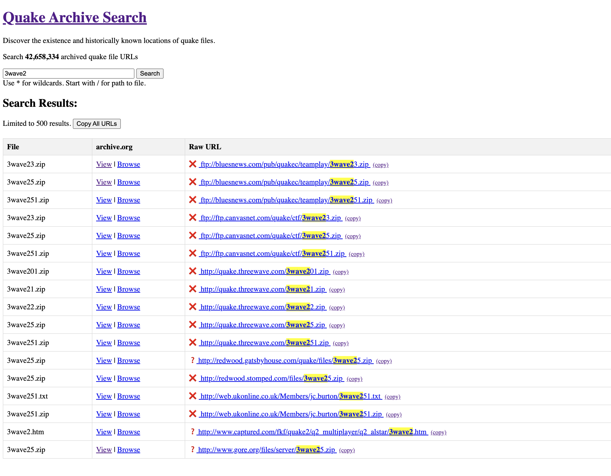

# Quake Archive Search

This project provides a searchable index of all known Quake file URLs.

* Discover the existence of quake releases (mods, maps, patches, etc.)
* Discover historical URLs where files were hosted and could be downloaded.

Screenshot of the web interface:



[See discussion circa Sep. 2024](https://discuss.quaddicted.com/t/find-rare-quake-files-new-archive-index-and-search).

[See more screenshots](pics/).

## Problem

The Quake community has produced a vast amount of content over the years, including mods, maps, texture packs, and other files. However, as time passes, many of these files become difficult to locate due to broken links, defunct websites, and scattered hosting locations. This situation makes it challenging for Quake enthusiasts to discover, access, and preserve this valuable content.

## Solution

The Quake Archive Search project addresses this issue by providing a comprehensive database and search tool for Quake file URLs. Key features include:

- A centralized index of known Quake file URLs
- Powerful search capabilities, including wildcard support
- Integration with the Internet Archive's Wayback Machine for accessing archived versions of files
- Tools for creating and updating the file archive from various sources
- A user-friendly web interface built with Flask
- Python scripts for programmatic access to the database

This project aims to serve as a vital resource for the Quake community, enabling easier discovery and preservation of Quake-related content.

## Why Not Just Use the Wayback Machine?

While the Internet Archive's Wayback Machine is an invaluable resource for accessing archived web content, it has limitations when it comes to discovering and accessing Quake-related files across multiple websites:

1. **Limited Cross-Site Search**: The Wayback Machine only allows searching within one website at a time. Our Quake Archive Search enables users to **search across all archived websites simultaneously**, greatly expanding the scope of discoverable content.

2. **No Archive Crawling**: The Wayback Machine doesn't crawl the content of archived webpages. This means that files and URLs listed within archived pages remain hidden unless manually inspected. Our tool **actively crawls and indexes the content of archived webpages**, uncovering a wealth of previously inaccessible Quake file URLs.

3. **Quake-Specific Focus**: Unlike the general-purpose Wayback Machine, our tool is **tailored specifically for the archived Quake webpages**. It understands the context of Quake file types, hosting patterns, and community-specific resources.

4. **Aggregation and Standardization**: We collect URLs from various sources, standardize their format, and remove duplicates, providing a clean, unified database of Quake file locations.

By addressing these specific issues, the Quake Archive Search project complements the Wayback Machine, offering a more powerful and targeted solution for preserving and accessing the rich history of Quake content.

## Setup

1. Install PostgreSQL and the Python dependencies. Follow the instructions in the comments at the top of `src/database_create_postgres.py`.
2. Create the PostgreSQL database and tables:

   ```bash
   python3 src/database_create_postgres.py
   ```

3. Check the `PYTHON` setting in the `Makefile` (currently `/usr/local/bin/python3`) and adjust it if necessary. Configure input files and other options at the top of the relevant scripts in `src/`.

Run the commands below from the project root.

## Common Tasks

| Command | What it does |
| --- | --- |
| `make server` | Start the Flask search interface at <http://127.0.0.1:5000/>. |
| `make check_db` | Check wishlist filenames against URLs in PostgreSQL. |
| `make check_files` | Check wishlist filenames against local text-file indexes. |
| `make wayback_crawl` | Crawl archived Wayback Machine pages for URLs. |
| `make web_crawl` | Crawl live websites for URLs. |
| `make dir_crawl` | Scan local directories for URLs and write a report. |
| `make user_crawl` | Index files from a user's Internet Archive CD uploads. |
| `make cd_crawl` | Index files multiple Internet Archive CD uploads. |
| `make extract_links` | Extract links from a webpage. |
| `make wayback_add` | Add website URLs from a text file to the Wayback processing database. |
| `make wayback_list` | Retrieve archived URLs for websites not yet processed. |
| `make wayback_delete` | Delete selected unprocessed website records; review the script before running. |
| `make import_lists` | Import URL lists from text files into PostgreSQL. |
| `make db_health` | Refresh URL statistics and show table health and sizes. |
| `make db-backup` | Create a compressed PostgreSQL backup in `data/backup/`. |

## Typical Workflow

1. Add website URLs to the input file configured in `src/process_wayback_add_all.py`, then run `make wayback_add`.
2. Run `make wayback_list` to retrieve URLs recorded by the Wayback Machine.
3. Use the crawl and import targets to discover and add more URLs.
4. Run `make db_health` after large imports and `make db-backup` to save a backup.
5. Run `make server` to search the URL index.

Some crawling tasks can take a long time. The scripts control their own input paths, exclusions, and rate limits.
